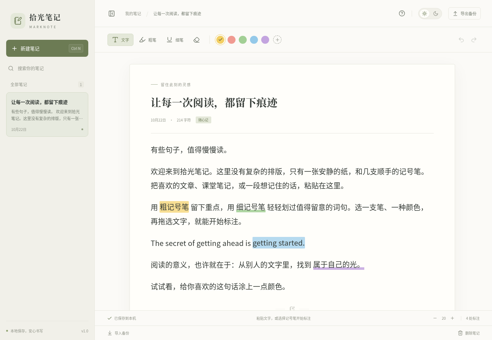
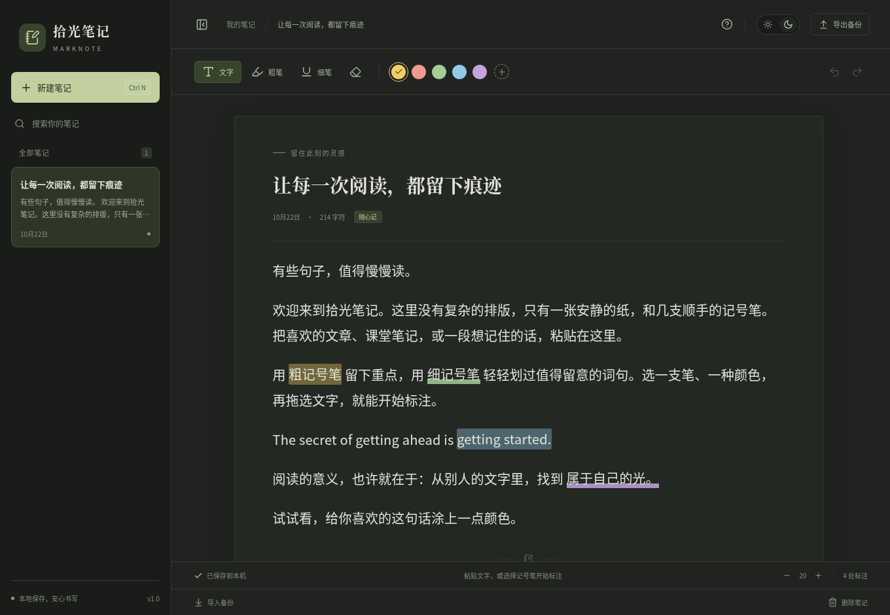

# 拾光笔记 · MarkNote

一张安静的纸，几支顺手的记号笔。为阅读和英语学习做的简洁桌面记事本。

**[下载 Windows 免安装版 v1.0.0](https://github.com/chixiaoyu0602/English-study-progarm/raw/refs/heads/main/downloads/MarkNote-1.0.0-Windows-x64.exe)** · [下载目录和 SHA-256 校验值](downloads/) · [自动构建](https://github.com/chixiaoyu0602/English-study-progarm/actions)

适用于 **Windows 10 / 11，64 位 x64**。下载 `.exe` 后双击运行，无需安装 Node.js、浏览器扩展或注册账号。应用完全离线；v1.0 没有云同步。当前构建未购买商业代码签名证书，发布者会显示为未知。



## 怎么用

1. 点「新建笔记」，填写标题，把文章复制粘贴到正文中，也可以直接输入文字。
2. 点「粗笔」添加文字底色，点「细笔」添加文字下方的窄色带。选好颜色后，按住鼠标拖选文字即可涂抹标注；也支持先选中文字再点记号笔或颜色。
3. 内置黄、红、绿、蓝、紫五种颜色。点颜色旁的 `+` 可以选颜色或输入 `#RRGGBB`，会保留最近 8 种自定义颜色。
4. 用橡皮擦拖选文字，清除该范围的标注。撤销、重做均支持键盘操作。
5. 右上角的太阳／月亮切换日间和夜间模式；底部的 `− / +` 调节阅读字号。

**笔记会自动保存到本机。**「导出备份」会保存所有笔记、标注和偏好为 `.marknote` 文件。点击「导入备份」恢复内容，导入会新增笔记，保留现有笔记；同一文件反复导入会产生副本。建议定期导出备份。

标注会跟随文字编辑、换行和窗口缩放。v1.0 提供针对文字的拖选标注，手绘图形和 PDF 标注不在此版本范围内。粘贴时会去掉来源网页的排版、图片和链接，只保留纯文本。

<details>
<summary>夜间模式</summary>



</details>

## 数据与快捷键

Windows 本地数据位于 `%APPDATA%\MarkNote\notebook.json`；旁边的 `.bak` 是上一次有效保存的备份。笔记不保存在 exe 所在目录，移动 exe 不会移动笔记。换电脑时请导出、导入 `.marknote` 文件。

写盘使用临时文件替换并保留上一次备份；关闭窗口会等待未完成的保存。若保存失败，界面会显示错误并在退出前提示。主文件损坏时会尝试恢复备份，并将损坏原文件另存为 `.corrupt-时间戳`；两个文件都无法读取时，原文件保持不动。

| 操作 | 快捷键 |
| --- | --- |
| 新建笔记 | `Ctrl N` |
| 立即保存 | `Ctrl S` |
| 撤销／重做 | `Ctrl Z` / `Ctrl Shift Z` |
| 粗笔／细笔 | `Ctrl Shift H` / `Ctrl Shift U` |
| 橡皮擦 | `Ctrl Shift E` |
| 回到文字工具、关闭弹窗 | `Esc` |

每篇最多 20 万字符，最多 500 篇笔记；整个笔记库和导入备份均限制为 10 MB。搜索支持标题和正文。切换笔记后会重新建立该篇的撤销历史，撤销历史不跨应用重启保存；删除笔记需要确认且不能撤销。

## 开发

技术栈：Electron + React + TypeScript + Vite + Tiptap / ProseMirror。界面无需远程字体或在线服务。

需要 Node.js **24 LTS** 和 npm。使用现有仓库检出即可，每个云任务已隔离，无需创建 Git worktree。

```sh
npm ci
npx install-electron --no
npm run dev         # 浏览器开发模式；数据保存在该浏览器的 localStorage
npm run desktop     # 构建并打开真正的桌面应用；数据写入磁盘
```

浏览器开发模式和桌面版使用各自独立的存储，均支持 `.marknote` 导入导出。

```sh
npx playwright install chromium
npm test            # 5 项数据校验测试 + 8 项界面功能测试
npm run test:desktop # 桌面桥接、磁盘保存、关闭刷新、备份导入导出与损坏恢复
npm run dist:win     # release/MarkNote-1.0.0-Windows-x64.exe
```

Windows 原生构建还可添加 `-- -c.win.signAndEditExecutable=true -c.win.signExecutable=false`，为应用嵌入图标和版本信息。Linux 交叉构建默认跳过 Windows 资源编辑，不需要 Wine，功能保持一致。

包内仅包含编译产物及桌面进程所需文件。React、Tiptap 等前端库已编译进界面资源，因此列于 `devDependencies`，无需随应用再次分发完整的 `node_modules`。

### 此云环境

系统已有 Chromium，可用 `CHROMIUM_PATH=/usr/bin/chromium npm test`。只读用户目录下的缓存放在 `/tmp`：

```sh
npm --cache /tmp/marknote-npm-cache ci
NODE_USE_ENV_PROXY=1 electron_config_cache=/tmp/marknote-electron-cache node node_modules/electron/install.js
XDG_CACHE_HOME=/tmp/marknote-cache npm run test:desktop
XDG_CACHE_HOME=/tmp/marknote-cache ELECTRON_BUILDER_CACHE=/tmp/marknote-builder-cache npm run dist:win -- -c.electronDownload.cache=/tmp/marknote-electron-cache
```

Electron 下载遵循系统代理和 CA 配置，并使用官方 checksum 校验。仅开发测试时可用 `MARKNOTE_USER_DATA_DIR` 指定独立的数据目录。Linux 无显示器的桌面测试使用 Chromium headless 平台；终端里的 D-Bus 提示不影响测试结果。

## 自动构建和发布

推送到 `main` 或创建 PR 会在 Windows 上运行测试、生成免安装包，并对**打包后的 Windows 程序**做桌面验证。通过后，在 Actions 对应运行的 Artifacts 中下载 `MarkNote-Windows-x64` 压缩包并解压即可得到 exe。

推送 `v*` 标签还会在测试全部通过后自动创建 GitHub Release，并上传 exe 和 `SHA256SUMS.txt`。工作流使用 GitHub 自带的临时令牌，不需要个人访问令牌。源码仓库中的 `downloads/` 也保留 v1.0.0 可执行文件，供直接下载；后续版本可通过 Releases 分发。

本次交付已通过 5 项数据校验测试、8 项界面测试、Linux 打包应用桌面验证，以及 [Windows 原生打包和打包后桌面验证](https://github.com/chixiaoyu0602/English-study-progarm/actions/runs/39752290827)。桌面验证涵盖实际磁盘写入、备份导入导出、关闭前最后一次编辑保存、重新启动和损坏文件恢复。`downloads/` 中的免安装包已从 GitHub 下载回验，SHA-256 与本地交付文件一致。

MIT License。
