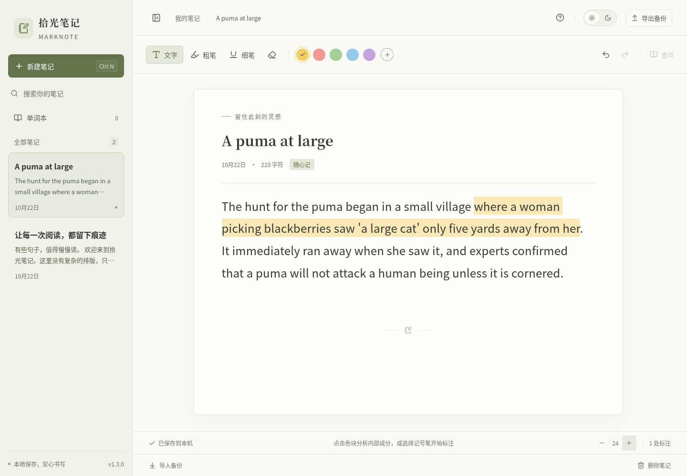
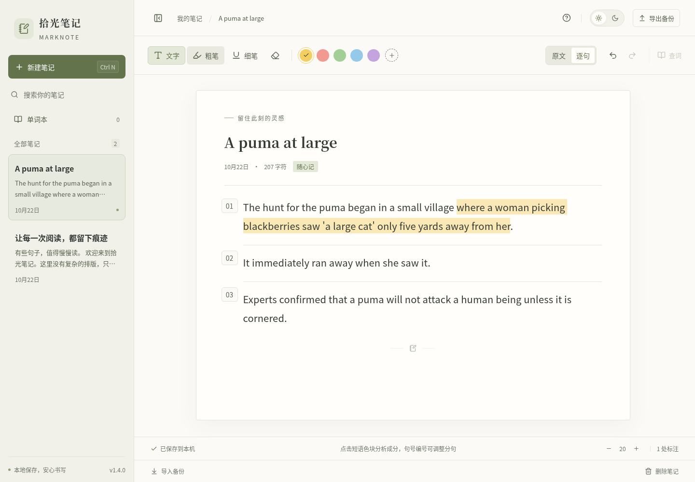
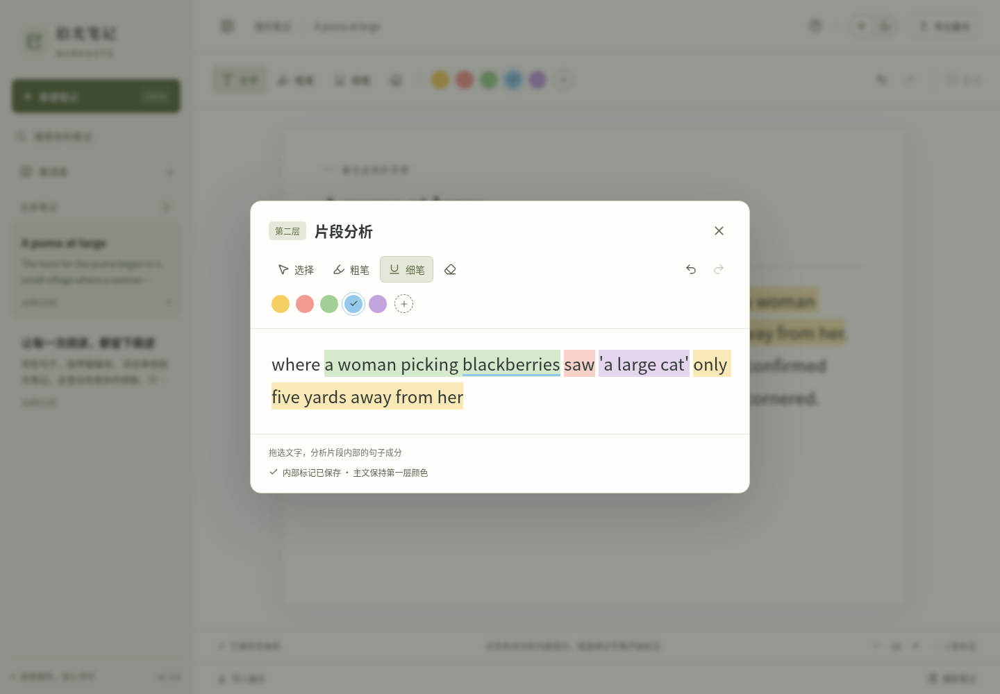
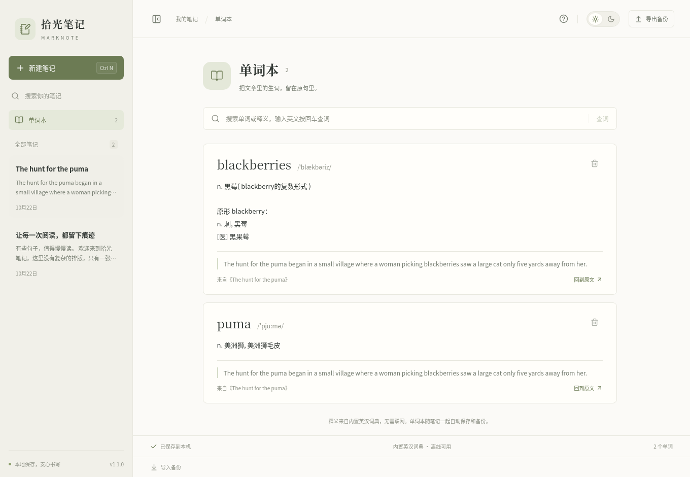
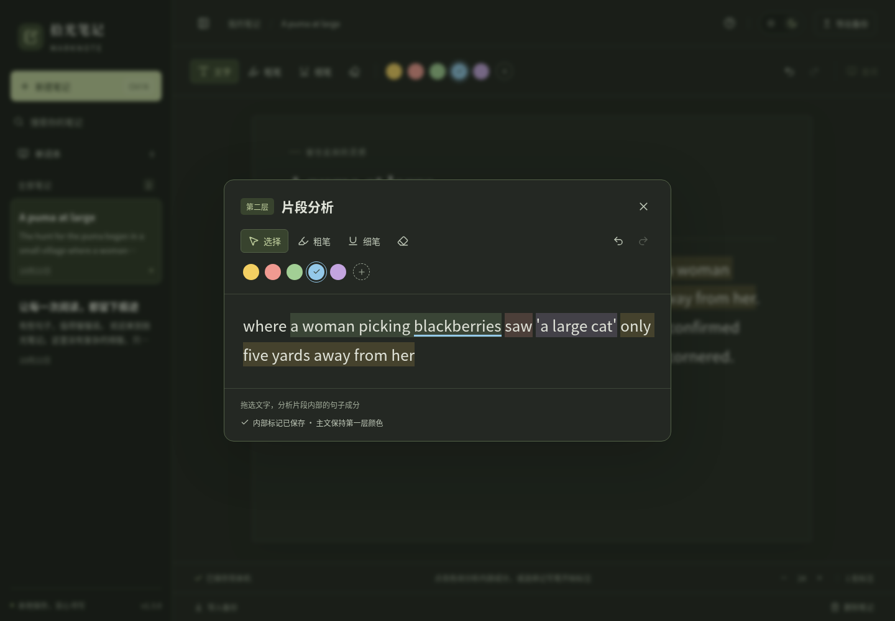

# 拾光笔记 · MarkNote

为英语精读准备的离线桌面笔记：粘贴文章，用颜色分析句子结构，将生词连同原句收藏。

**[下载 Windows 免安装版 v1.4.0](https://github.com/chixiaoyu0602/English-study-progarm/releases/download/v1.4.0/MarkNote-1.4.0-Windows-x64.exe)** · [版本和 SHA-256 校验值](https://github.com/chixiaoyu0602/English-study-progarm/releases/tag/v1.4.0) · [自动构建](https://github.com/chixiaoyu0602/English-study-progarm/actions)

适用于 **Windows 10 / 11，64 位 x64**。下载 `.exe` 后双击运行，无需安装 Node.js、浏览器扩展或注册账号。应用完全离线，没有云同步。当前构建未购买商业代码签名证书，发布者会显示为未知。



## v1.4.0：逐句精读与本地发音

- **单词保持简洁**：单个英文单词的色块不再打开二级界面；`don't`、`well-known` 也按一个单词处理。短语和从句仍然可以点击分析，即使还没有内部标记。已保存的单词内部标记保留，右键查词继续可用。
- **一句一个阅读单元**：工具栏可切换「原文／逐句」，默认逐句显示。编号、留白和中性分隔线帮助辨认句子，颜色继续用于语法成分。日夜模式、字号、文字编辑和标注均适配；切换方式会记住。
- **可以修正分句**：点击句子编号，选择「与上一句合并」「在文字光标处分句」或「恢复本篇自动分句」。手动分句前，在正文中点好光标，再打开该句编号的菜单。分句修正随文字编辑定位并自动保存，也包含在备份里。段落之间保留原来的边界；编号、分隔线不会写进正文或复制内容。
- **单词本小喇叭**：使用 Windows 自带的英语语音，优先根据规范化后的 IPA 音标合成；音标或语音不支持时使用「系统读音」，界面明确区分。再次点击可停止，切换单词或离开单词本会结束播放。无需下载大型模型、注册账号或填写 API 密钥。



Windows 发音需要已安装、能由系统桌面语音接口使用的英语语音。应用优先选择英式英语语音，否则使用可用的英语语音；缺少时会提示在 Windows「设置 → 时间和语言 → 语音」中添加。首次安装语音包可能需要联网，安装后发音可离线。合成语音的音质由本地语音决定，不能保证每个旧词典音标都受支持。浏览器开发模式只使用本地英语语音按拼写朗读，标为「系统读音」。

分句使用本地规则，并处理 `Mr.`、`Dr.`、人名首字母等常见缩写；特殊句式可以手动修正。逐句布局保留现有色块的原始范围，不会批量拆分或重写旧标注。

## v1.3.0：主文看结构，点开分析成分

1. 在主文给整个从句或短语涂色，表达第一层结构。
2. **点击含多个英文单词的色块**，打开「片段分析」。第一次打开时，里面是同一段文字，没有外层底色。
3. 在小框内用粗笔、细笔和不同颜色分析主谓宾等内部成分。同一种黄色也可以使用，外层黄色不会干扰判断。
4. 关闭小框后，主文始终只显示第一层。再次打开时保留内部标记，只有主文、片段这两层，不会再弹出第三层。



内部标记自动保存，也包含在 `.marknote` 备份里。支持预设和自定义颜色、粗细笔、橡皮、撤销和重做。分析框只做标注；文字在主文修改，框内内容自动同步，避免同一文章出现两份不同的文字。

完整色块换色会保留内部分析；在主文重新划分部分范围时，所选部分成为新的第一层标记。主文橡皮会一并擦除选中范围的内部分析，可用撤销恢复；分析框里的橡皮只擦内部标记。

原有文章和单词本会自动升级。旧版的底色留在主文，内层标记迁入分析框；旧颜色保留在内部，正常阅读时不再层层叠色。新备份格式为 **4**，请使用 **v1.3.0 或更新版本**打开，旧版会拒绝新格式以免丢失分析数据。

## 离线单词本

- 文章中右键单词，查看中文释义和音标，一键加入单词本；也支持选中文字后点「查词」或按 `Ctrl D`。记号笔模式下右键也能查词，不会误涂文字。
- 内置 ECDICT 的 **398,433 个英汉单词词条**，无需联网、账号或 API 密钥。对有原形信息的词，同时显示原形释义，例如 `ran` 会补充 `run` 的中文解释。
- 收藏时自动保存文章原句和出处，可从单词本回到原文。支持搜索、去重、移出单词本；移除文章后仍保留已收藏的原句。
- 单词本和文章一起自动保存和备份。导入备份会合并单词，按单词去重，并修复导入文章的出处链接。



词典列出词语的多个义项，结合原句判断具体含义。暂未收录的词会明确提示；不会凭空生成释义。单词本也可以直接输入英文查词并收藏。

## 标注工具

- 粗笔使用宽笔头光标，细笔使用尖笔头光标，笔头显示当前颜色；橡皮擦也有独立图标。
- 主文与分析框分别显示自己的标记。粗笔添加底色，细笔添加下方窄色带；框内可以组合使用，重涂同一位置会替换对应笔型的颜色。
- 标记跟随原文编辑、换行和窗口缩放；相邻的两个同色色块也能分别打开，内部分析不会混在一起。


## 怎么用

1. 点「新建笔记」，填写标题，把文章复制粘贴到正文中，也可以直接输入文字。
2. 点「粗笔」添加文字底色，点「细笔」添加文字下方的窄色带。选好颜色后，按住鼠标拖选文字即可涂抹标注；也支持先选中文字再点记号笔或颜色。
3. 内置黄、红、绿、蓝、紫五种颜色。点颜色旁的 `+` 可以选颜色或输入 `#RRGGBB`，会保留最近 8 种自定义颜色。
4. 用橡皮擦拖选文字，擦除主文标记；在分析框内使用橡皮只影响内部标记。撤销、重做均支持键盘操作。
5. 右上角的太阳／月亮切换日间和夜间模式；底部的 `− / +` 调节阅读字号。

在文章中**右键生词**，点「加入单词本」，即可收藏带中文释义和原句的单词。左侧「单词本」可随时查看。

**笔记和单词本会自动保存到本机。**「导出备份」会保存所有笔记、标注、单词本和偏好为 `.marknote` 文件。点击「导入备份」恢复内容，导入会新增笔记，单词按词头去重并保留已有释义；同一文件反复导入会产生文章副本，但不会重复添加相同单词。建议定期导出备份。

标注会跟随文字编辑、换行和窗口缩放。提供针对文字的拖选标注，手绘图形和 PDF 标注不在此版本范围内。粘贴时会去掉来源网页的排版、图片和链接，只保留纯文本。

<details>
<summary>夜间模式</summary>



</details>

## 数据与快捷键

Windows 本地数据位于 `%APPDATA%\MarkNote\notebook.json`；旁边的 `.bak` 是上一次有效保存的备份。笔记不保存在 exe 所在目录，移动 exe 不会移动笔记。换电脑时请导出、导入 `.marknote` 文件。

写盘使用临时文件替换并保留上一次备份；关闭窗口会等待未完成的保存。若保存失败，界面会显示错误并在退出前提示。主文件损坏时会尝试恢复备份，并将损坏原文件另存为 `.corrupt-时间戳`；两个文件都无法读取时，原文件保持不动。

| 操作 | 快捷键 |
| --- | --- |
| 选词查释义和收藏 | `Ctrl D` 或右键单词 |
| 新建笔记 | `Ctrl N` |
| 立即保存 | `Ctrl S` |
| 撤销／重做 | `Ctrl Z` / `Ctrl Shift Z` |
| 粗笔／细笔 | `Ctrl Shift H` / `Ctrl Shift U` |
| 橡皮擦 | `Ctrl Shift E` |
| 回到文字工具、关闭弹窗 | `Esc` |

每篇最多 20 万字符，最多 500 篇笔记、5000 个收藏单词；整个用户笔记库和导入备份均限制为 10 MB（内置词典不占此额度）。搜索支持标题和正文。切换笔记后会重新建立该篇的撤销历史，切换单词本再返回同一文章时保留撤销历史，撤销历史不跨应用重启保存；删除笔记需要确认且不能撤销。

## 开发

技术栈：Electron + React + TypeScript + Vite + Tiptap / ProseMirror。界面无需远程字体或在线服务。

需要 Node.js **24 LTS** 和 npm。使用现有仓库检出即可，每个云任务已隔离，无需创建 Git worktree。

```sh
npm ci
npx install-electron --no
npm run dev         # 浏览器开发模式；数据保存在该浏览器的 localStorage
npm run desktop     # 构建并打开真正的桌面应用；数据写入磁盘
```

浏览器开发模式和桌面版使用各自独立的存储，均支持 `.marknote` 导入导出。

```sh
npx playwright install chromium
npm test            # 28 项词典／数据／标记范围测试 + 33 项界面功能测试
npm run test:speech  # Windows 本地语音：实际合成 IPA／系统读音为 WAV 并校验
npm run test:desktop # 桌面桥接、磁盘保存、关闭刷新、备份导入导出与损坏恢复
npm run dist:win     # release/MarkNote-1.4.0-Windows-x64.exe
```

Windows 原生构建可在 `npm run build` 后运行 `node scripts/package-windows.mjs`，嵌入图标和版本信息，同时避免 Windows 命令行的参数解析差异。Linux 交叉构建默认跳过 Windows 资源编辑，不需要 Wine，功能保持一致。

包内仅包含编译产物及桌面进程所需文件。React、Tiptap 等前端库已编译进界面资源，因此列于 `devDependencies`，无需随应用再次分发完整的 `node_modules`。

### 此云环境

系统已有 Chromium，可用 `CHROMIUM_PATH=/usr/bin/chromium npm test`。只读用户目录下的缓存放在 `/tmp`：

```sh
npm --cache /tmp/marknote-npm-cache ci
NODE_USE_ENV_PROXY=1 electron_config_cache=/tmp/marknote-electron-cache node node_modules/electron/install.js
XDG_CACHE_HOME=/tmp/marknote-cache npm run test:desktop
XDG_CACHE_HOME=/tmp/marknote-cache ELECTRON_BUILDER_CACHE=/tmp/marknote-builder-cache npm run dist:win -- -c.electronDownload.cache=/tmp/marknote-electron-cache
```

Electron 下载遵循系统代理和 CA 配置，并使用官方 checksum 校验。仅开发测试时可用 `MARKNOTE_USER_DATA_DIR` 指定独立的数据目录。Linux 无显示器的桌面测试使用 Chromium headless 平台；终端里的 D-Bus 提示不影响测试结果。

## 自动构建和发布

推送到 `main` 或创建 PR 会在 Windows 上运行测试、生成免安装包，并对**打包后的 Windows 程序**做桌面验证。通过后，在 Actions 对应运行的 Artifacts 中下载 `MarkNote-Windows-x64` 压缩包并解压即可得到 exe。

推送 `v*` 标签还会在测试全部通过后自动创建 GitHub Release，并上传 exe 和 `SHA256SUMS.txt`。工作流使用 GitHub 自带的临时令牌，不需要个人访问令牌。源码仓库中的 `downloads/` 也保留 v1.0.0 可执行文件，供直接下载；后续版本可通过 Releases 分发。

自动测试覆盖内置词典、单词本、出处、备份迁移、片段打开与关闭、两层颜色隔离、跨段拖选、自定义颜色、文字同步、键盘操作、擦除和撤销。桌面验证在渲染器明确断网的情况下查词，确认真实磁盘保存、导入导出和重启恢复。Windows 流水线还会对打包后的 exe 运行相同的桌面验证，并用包内语音脚本实际合成离线 WAV，验证音标接口和语音文件都可用；对应结果可在上方自动构建页面查看。

## 词典来源与复现

词条数据来自 [skywind3000/ECDICT](https://github.com/skywind3000/ECDICT)，固定在提交 `bc015ed2e24a7abef49fc6dbbb7fe32c1dadaf8b`，按其 MIT 许可证分发。完整署名和许可随程序包含在 [DICTIONARY-LICENSE.txt](public/DICTIONARY-LICENSE.txt) 中。原始数据包含 76 万余条词语，本程序保留有中文释义的英文单词、连字符词和缩略词，包含音标、原形及词形信息。

词典数据按首字母分包，查词时按需加载，不影响正常阅读的启动速度；运行中所有内容均来自程序本地。构建产物与用户笔记分开存储。数据与每个分包的 SHA-256 记录在 [metadata.json](src/data/dictionary/metadata.json) 中。

词库已提交到仓库，普通开发和打包不需要下载或重新生成。需要复现时使用 Python 3：

```sh
python3 scripts/build-dictionary.py
```

脚本从固定提交下载原始 CSV 和许可证，严格校验 SHA-256 后生成相同分包；也支持 `--source /path/ecdict.csv --license /path/LICENSE` 复用已下载的原始文件。新版笔记备份格式为 4，自动兼容格式 1、2、3 的旧文章、标注和单词本。包含片段分析的备份请用 v1.3.0 或更新版本打开。

应用代码采用 MIT License。
